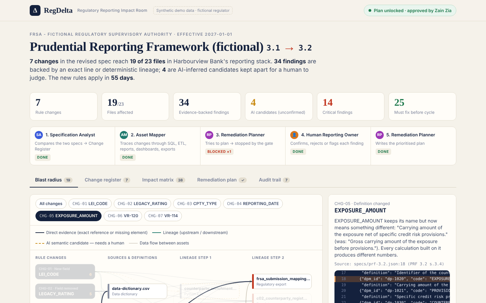
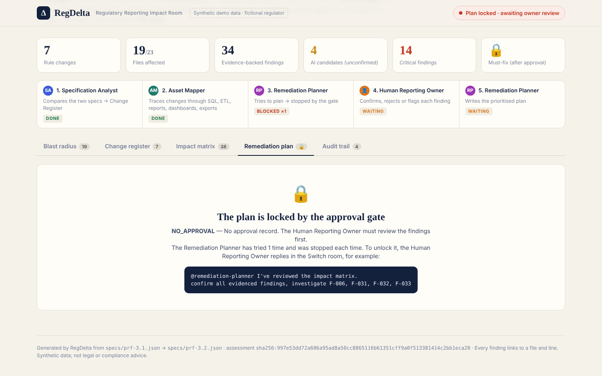
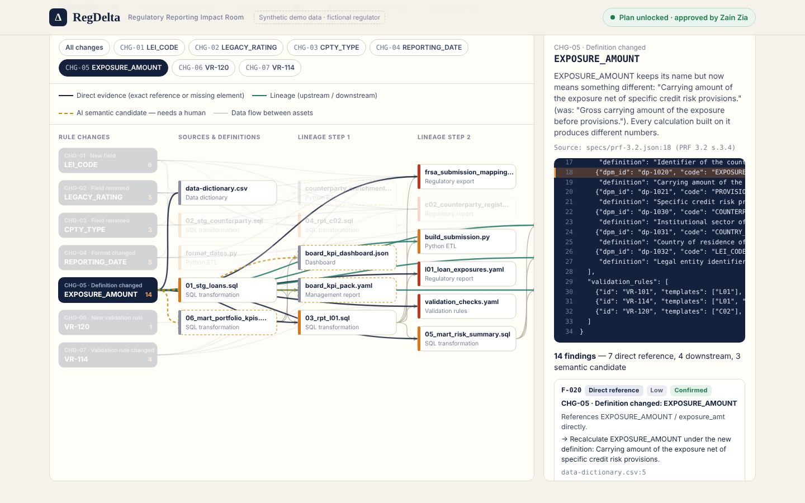

# RegDelta — the Regulatory Reporting Impact Room

**A regulator changes a reporting rule. Which of your SQL jobs, reports, dashboards and submission files break?**
RegDelta answers that *before* anyone starts implementing — in one Switch room where three AI agents and a human reporting owner work it out together, with a file-and-line receipt for every claim.

**[▶ Open the live Impact Room demo](https://gosho1992.github.io/regdelta/)** · Built for the *Flip the Switch* hackathon — Best Business Workflow track



---

## The problem, in plain words

Banks, insurers and other regulated companies send the regulator reports built from many layers: source data → SQL → reporting tables → report templates → validation checks → an export file. The regulator revises its specification regularly (the EBA, for example, updates its validation rules alongside each framework release and in extra quarterly packages).

Reading what changed is the easy part. The hard part is knowing **which of your own files are affected** — the knowledge is spread across repositories and people. Miss one dependency and the bank submits wrong or rejected data. CUBE's 2025 survey of 2,000+ compliance officers found 21% rate their regulatory change management as ineffective and that full implementation of a change takes over a year on average.

General regulatory-change platforms (CUBE, Ascent) map rules to *obligations and policies*. RegDelta does the engineering step they leave out: it maps a supplied spec change to *your technical assets*.

## What happens in the room

| # | Who | Does what | Leaves in the room |
|---|---|---|---|
| 1 | 🧑 **Human Reporting Owner** | Drops the new spec in the room | — |
| 2 | 🤖 **Specification Analyst** | Diffs old vs new spec: new / removed / renamed fields, format and definition changes, rule changes | **Change Register** (each change → spec file:line) |
| 3 | 🤖 **Asset Mapper** | Traces each change through SQL, Python ETL, report definitions, validation rules, dashboards and the export — then up and down the data lineage | **Impact Matrix**, **Dependency Map**, the Impact Room page |
| 4 | 🤖 **Remediation Planner** | Tries to write the plan → **blocked by the approval gate** | Gate result + a ready-to-copy review reply |
| 5 | 🧑 **Human Reporting Owner** | Confirms / rejects / flags findings in one chat message | **Approval record**, bound to this exact assessment |
| 6 | 🤖 **Remediation Planner** | Gate opens → prioritised plan: must-fix, should-fix, monitor, owners, re-run order | **Remediation Plan** |

RegDelta never edits the reporting assets. The output is a plan for people.

## Why you can trust the findings

Most "AI impact analysis" is an LLM guessing. RegDelta splits the work:

- **A deterministic engine (no LLM)** finds every exact reference, every *missing* required element, and the table/import lineage — each with `file:line` evidence that the tests re-open and check.
- **AI agents** explain, summarise, hand off and give opinions on the uncertain bits.
- **Semantic candidates** (wording that *looks* related but never references the field) are labelled separately, never shown as confirmed, and need a human decision.

| Finding type | Meaning | Example from the demo |
|---|---|---|
| Missing element | Asset produces an affected template but lacks the new field/rule (absence verified) | `c02_counterparty_register.yaml:3` has no `LEI_CODE` |
| Direct reference | File names the changed field, its internal column, rule ID or old format | `format_dates.py:6` → `"%d/%m/%Y"` |
| Upstream feeder | Builds a table the report reads, so the new field must flow through it | `04_rpt_c02.sql` → `02_stg_counterparty.sql` |
| Downstream | Consumes output of an affected asset (table lineage or Python import) | `03_rpt_l01.sql → rpt_l01 → 05_mart → mart_risk_summary → credit_risk_dashboard.json` |
| Semantic candidate | Related wording, no reference — human must judge | `06_mart_portfolio_kpis.sql` mentions "gross carrying amount" |

### The approval gate (`gate.py`)

The plan only unlocks when a valid approval exists **for this exact assessment**. The gate recomputes a SHA-256 fingerprint over both specs, every scanned asset file and every finding, *from disk*, every time.

| Situation | Gate |
|---|---|
| No approval record | 🔒 `NO_APPROVAL` |
| Broken / malformed record | 🔒 `INVALID_APPROVAL` |
| Reviewer is an agent | 🔒 `NOT_A_HUMAN_REVIEWER` |
| A finding was edited, or an asset/spec changed after approval | 🔒 `FINGERPRINT_MISMATCH` |
| A finding has no decision | 🔒 `INCOMPLETE_DECISIONS` |
| Human decisions cover every finding of this assessment | ✅ `OK` |



This is a prototype workflow control, not production security: a real deployment needs signed approvals, identity from the chat platform and tamper-resistant storage.

## Try it in 60 seconds (no Switch needed)

Python 3.9+, **zero dependencies**.

```bash
git clone https://github.com/Gosho1992/regdelta.git
cd regdelta
python -m regdelta demo --out out      # full run: blocked -> human approval -> plan -> tamper test
python -m unittest -v                  # 19 acceptance tests
```

Open `out/index.html` in a browser. Or open the repo in **GitHub Codespaces** — the dev container runs the tests and the demo on start.

<details><summary>Example demo output</summary>

```text
=== 3. Remediation Planner tries to write the plan before any human review ===
  -> BLOCKED [NO_APPROVAL] No approval record. The Human Reporting Owner must review the findings first.
=== 4. Human Reporting Owner reviews in the Switch room and approves ===
  Zain Zia: "confirm all evidenced, investigate F-006, F-031, F-032, reject F-033"
=== 5. Remediation Planner tries again ===
  -> ALLOWED [OK] Approved by Zain Zia
  Plan: 25 must-fix, 9 should-fix, 3 monitor
=== 6. Tamper check: edit one finding after approval, in a copy ===
  Downgrading F-002 (exports/frsa_submission_mapping.yaml) from Critical to Low after approval...
  -> BLOCKED [FINGERPRINT_MISMATCH] The approval was given for a different assessment ...
```
</details>

## How Switch is used (and why the project needs it)

Switch turns a chat channel into a **room** where people and AI agents work from the same conversation, decisions and documents. RegDelta *is* a room:

| Switch feature | How RegDelta uses it |
|---|---|
| **Room per change** | One room per reporting change — the whole analysis, review and decision history in one place |
| **Three agents with roles** | `regdelta-spec-analyst`, `regdelta-asset-mapper`, `regdelta-remediation-planner` — each a Claude Code (or Codex/OpenCode) agent with its own brief |
| **Agent-to-agent hand-offs** | Each agent `@mentions` the next when its stage is done; addressing is `owner-agents`, so only you and your agents can drive them |
| **Shared working directory** | All three agents work in one folder, so the outputs of one are the inputs of the next |
| **Room documents** | Change Register, Impact Matrix, Dependency Map and Remediation Plan are saved as room documents |
| **Human in the room** | The reporting owner approves *in the chat*; the planner records their words verbatim in the approval record |
| **Room instructions + template** | `switch/regdelta-room.template.yaml` creates the 3 agents, the room, its briefing and the kickoff in one click (validated with Switch's own template linter) |

Without Switch the engine still runs from the CLI, but the multi-agent hand-offs, the human decision in the shared conversation and the room's decision trail would have to be rebuilt elsewhere.

### Run it in Switch

1. Install **Node.js 20+**, **Switch Console** ([releases](https://github.com/sandbox-quantum/switch/releases/latest)) and **Claude Code** (`npm i -g @anthropic-ai/claude-code`, run `claude` once to log in). Python 3.9+ must be on the PATH.
2. Switch Console → **Add a server** → **Run a server on this computer** (no Docker needed).
3. Connect a messaging app (Server Home → **Messaging apps** → Connect):
   - **Discord / Slack / Mattermost:** Templates → *Use a template* → paste [`switch/regdelta-room.template.yaml`](switch/regdelta-room.template.yaml) → **Create**. You get the 3 agents, the `regdelta-impact-room` channel, its instructions, and the kickoff message.
   - **Telegram** (bots can't create chats): create a group, add your Switch bot, send one message, link your account in Switch Console, then use [`switch/regdelta-team.template.yaml`](switch/regdelta-team.template.yaml) and pick that group as *Room to join*. Paste [`switch/room-instructions.md`](switch/room-instructions.md) into the room's instructions and post [`switch/kickoff.md`](switch/kickoff.md).
4. Watch the agents hand off. When the planner asks for review, reply e.g.
   `@regdelta-remediation-planner confirm all evidenced, investigate F-006, F-031, F-032, reject F-033`
5. Open `out/index.html` in the shared folder (path posted by the Asset Mapper) for the full Impact Room page.

Agent briefs: [`agents/rendered/`](agents/rendered) (source: `agents/*.md`, rendered into the templates by `scripts/build_templates.py`).

## The demo scenario (synthetic)

*Harbourview Bank* (fictional) receives **PRF 3.1 → 3.2** from the fictional regulator **FRSA**. Everything in `fixtures/` is invented — not a real regulatory notice.

| Change | What it means |
|---|---|
| CHG-01 New mandatory field `LEI_CODE` (C02) | Counterparty register and export must carry a Legal Entity Identifier |
| CHG-02 `LEGACY_RATING` removed | Stop sending it |
| CHG-03 `CPTY_TYPE` → `COUNTERPARTY_SECTOR` | Same data point, new code |
| CHG-04 `REPORTING_DATE` `DD/MM/YYYY` → `YYYY-MM-DD` | Formatting code and export mapping produce rejected files |
| CHG-05 `EXPOSURE_AMOUNT` now *net* of provisions | Same name, new meaning — every calculation built on it changes |
| CHG-06 New rule `VR-120` | LEI format check missing from pre-submission validation |
| CHG-07 `VR-114` now links L01 ↔ C02, warning → error | The two reports must agree; failures now block submission |

The stack has 23 assets (7 SQL, 3 Python ETL, 9 report/validation definitions, 2 dashboards, 1 export mapping, 1 data dictionary), including 4 unrelated assets as negative controls. Ground truth is hand-written in [`fixtures/expected.json`](fixtures/expected.json).

**Result:** 38 findings on 19 assets — 34 deterministic, 4 semantic candidates — 14 Critical.

## Proposal success criteria → tests

| Criterion | Test |
|---|---|
| Every seeded direct dependency is found | `test_all_seeded_dependencies_found_exactly` (exact match per change and type) |
| No false positives on unrelated assets | `test_no_false_positives_on_unrelated_assets` |
| Every finding has a verifiable source location | `test_every_finding_has_verifiable_evidence` (re-opens each file:line) |
| Missing-element findings are really missing | `test_gap_findings_really_lack_the_element` |
| Uncertain relationships labelled as candidates | `test_candidates_are_never_presented_as_confirmed` |
| Dependency map reaches downstream assets | `test_dependency_map_reaches_downstream_assets` |
| Plan blocked before approval | `test_blocked_without_approval`, `..._invalid_record`, `..._for_another_assessment`, `..._edited_after_approval`, `..._asset_changes_after_approval`, `test_agents_cannot_approve`, `test_incomplete_decisions_block` |
| Plan available after valid approval, follows decisions | `test_valid_approval_opens_gate_and_plan_follows_decisions` |
| No production asset is modified | `test_workspace_untouched` (hash of `fixtures/` before/after) |
| Clean-clone reproducibility | CI on Ubuntu + Windows, Python 3.9 and 3.12 |

## CLI

```text
python -m regdelta analyze   # Stage 1  Change Register
python -m regdelta map       # Stage 2-3 Impact Matrix, Dependency Map, graph, review sheet
python -m regdelta plan      # Stage 5  blocked until approved
python -m regdelta review --reviewer "Name" --confirm all-evidenced --investigate F-006 --message "..."
python -m regdelta gate      # or: python gate.py   (exit 0 = open)
python -m regdelta status    # one paragraph for the room
python -m regdelta ui        # out/index.html
```

Use your own assets: `--workspace path/to/repo --old specs/v1.json --new specs/v2.json` (spec format: see `fixtures/harbourview-bank/specs/`).

Outputs in `out/`: `change-register.md`, `impact-matrix.csv`, `dependency-map.md` (Mermaid), `dependency-graph.json`, `review-sheet.md`, `approval-record.json`, `remediation-plan.md`, `assessment.json`, `gate-log.jsonl`, `events.jsonl`, `index.html`.



## Limits (honest)

- The demo is synthetic. It proves the workflow and the evidence quality, not coverage of arbitrary real systems; a pilot against a real historical change is the next step.
- Lineage is table-level and import-level, not column-level. Downstream findings mean "potentially affected — verify".
- Specs must be supplied in the structured JSON format (EBA-style data points and rules). Parsing PDFs/XBRL taxonomies is future work.
- Not legal advice, not compliance certification, no automatic fixes.

## Sources

- [CUBE — Cost of Compliance Report 2025](https://www.prnewswire.com/news-releases/cube-launches-industry-leading-cost-of-compliance-report-2025-highlighting-role-of-ai-in-tackling-global-regulatory-complexity-302606240.html)
- [EBA — DPM Data Dictionary](https://eba.europa.eu/risk-and-data-analysis/reporting/dpm-data-dictionary) · [EBA — Validation rules packages](https://www.eba.europa.eu/risk-and-data-analysis/reporting/reporting-frameworks/validation-rules-packages)
- [Layline — 50 data pipeline postmortems](https://layline.io/resources/blog/2026-05-19-data-pipeline-postmortems/) (schema drift in 38% of a selected, non-random sample)
- [Switch](https://github.com/sandbox-quantum/switch) · [Switch docs](https://docs.switchagents.ai/switch-rooms/getting-started)

MIT licensed.
